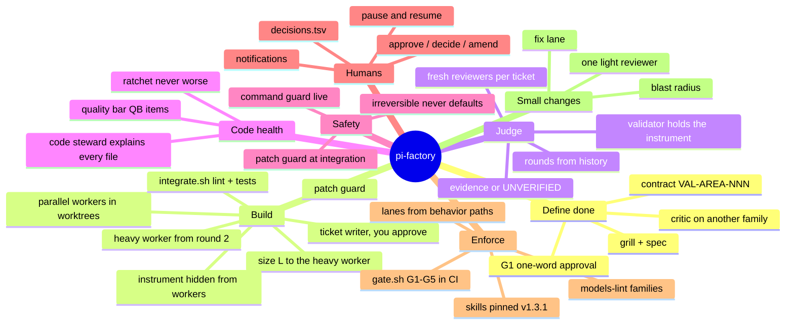
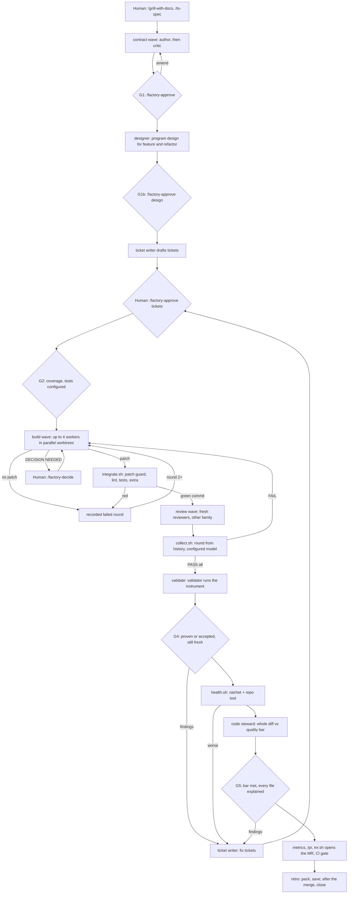

# pi-factory

**An agnostic, agentic software factory for [Pi](https://github.com/badlogic/pi-mono).** It builds and maintains whatever you work on (a bot, an API, a front end, a batch job, in any language) with one disciplined loop. What it knows about *your* kind of software and *your* company's taste comes from files you own: `AGENTS.md`, the quality bar, and optional practice packs.

## Why it exists

**Delegate, don't supervise.** Chatting with agents is micromanagement: many tools, many conversations, every mistake corrected by hand, the human still in the loop. The factory aims at delegation instead: **one task, one owner; assign it and walk away; check the verifiable result at the end.**

Delegation needs three things:

1. **A complete assignment.** A spec and a validation contract that settle every decision before any code exists. When they do, the agents have nothing to ask: one mission ran with zero questions to the human.
2. **An owner.** A scripted loop carries the task to the end: fresh agents build, review and validate; scripts, not a model, decide what happens next and keep the record.
3. **A check that doesn't need the human.** Every claim is backed by evidence, by judges from another model family, and, wherever a script can decide, by a script. This is the part still being built: in one mission every gate was green and a changed public type got through; only a ten-second mechanical check found it. [P23](docs/proposals/P23-gates-that-cannot-be-fooled.md) is the plan to make that check a command.

> **The goal:** shift the work, not the volume. Correction and maintenance run in the background, verified by the factory itself, so the team spends its time on what was never in scope. Agents that write in three days what takes three days to review move the cost, they don't remove it. Self-verification comes first, better models second. See [docs/INTENT.md](docs/INTENT.md).

## How it works, in one paragraph

You write the spec and approve the definition of done. A contract of numbered assertions is written, attacked by a critic, and approved by you before any ticket exists. Fresh-context agents build tickets in parallel worktrees; each patch passes a guard, lint and tests before a reviewer from another model family sees it; a validator checks behavior against cases the workers never see; a ratchet and a code steward hold code health. Scripts decide every next step and keep the record in files. CI enforces the gates on every merge request. You come back at a handful of human steps: approve the contract, the design, the tickets, the merge.

The principles, borrowed from Factory's *Missions* and hardened over six missions:

- **Fresh context per role.** Every role is a new subagent with a generated brief of file paths and only what its job needs, never the lead's summary.
- **The contract before the code.** Assertion IDs, written, attacked, approved; a wrong assertion becomes an amendment, never a quiet edit.
- **Validators report and never fix.** A finding becomes a ticket.
- **State in files.** Missions live in `.scratch/<mission>/`, committed, so any session can pick up.
- **Judges from another model family.** Critic ≠ author; reviewers, validator and steward ≠ workers, linted in CI.
- **Scripts decide what code can decide.** Rounds, models, staleness, guards and gates are computed, never self-reported. A model judges only what is left.
- **The intent sets the reference.** Feature and bugfix: the contract; refactor: frozen tests that don't change by a line; maintenance: today's code.
- **Agents can't do harm.** A command guard blocks dangerous tool calls live and scrubs secrets from their environment; a patch guard rejects unsafe changes deterministically.
- **Agnostic machinery, owned content.** No language or framework baked in; practices arrive as content the roles read.

## How it measures and improves itself

A factory built on non-deterministic parts is only as good as what it measures. Everything below runs on your machine; transcripts and retros stay private, outside every repository.

| Instrument | What it answers | Where |
|---|---|---|
| Run archive | What did each agent read, run and answer? | `factory archive` (D97) |
| `factory tokens` | Where do the tokens go, request by request? | P20 |
| `factory frictions` | Where did agents fight their setup: failed, repeated, refused calls? | P23 |
| `metrics.sh` | Rounds, first-pass rate, decisions, cost per mission | D85 |
| Benchmark | Is this model or brief better on our own past tickets? Paired, with a confidence interval | `bench.sh` (D98) |
| Retro | What went wrong, with evidence; after the merge, what the team found that the gates missed | `retro.sh pack`, `save`, `close` |
| `factory learn` | Which findings recur across missions and projects? Scrubbed to share | P15 groundwork |

The rule for every improvement: count before judging, measure before and after, and trust a judge only once it has been checked against labelled cases.

> **Where this stands:** v1.4 (release candidates), six missions run on real projects. The last three: 12 tickets at 66% first-pass review and 14 human decisions; then 8 tickets at 100% and 2; then 4 tickets at 100%, zero questions, and one defect that every gate missed. Step 2 on Boris Cherny's adoption ladder; Step 3 waits on item 3 above. See [docs/LADDER.md](docs/LADDER.md) and the [next release plan](docs/proposals/P23-gates-that-cannot-be-fooled.md#release-plan-what-goes-into-the-next-release).

**Start here:** [INTENT.md](docs/INTENT.md) (why it exists and how we measure the gain) · [DESIGN.md](docs/DESIGN.md) (how it works and why, one idea per section) · [CHEATSHEET.md](CHEATSHEET.md) (everything you type) · [ADR-001](docs/adr/ADR-001-agentic-factory.md) (every decision, in order) · [proposals](docs/proposals/README.md) (what comes next, with evidence) · [mission 1 case study](docs/case-studies/mission-01.md)

---

## The map



## A mission, end to end



You type `/factory <mission>` once. The lead loops on `scripts/factory/next.sh`, which prints a `STEP:` code. Machine steps run on their own, and human steps stop the loop and notify you. A ticket that fails three rounds escalates to you; the cause is usually a wrong contract or a ticket that is too big.

## The roles

| Agent | Does | Model guidance | Context |
|---|---|---|---|
| `factory-contract-author` | Writes or amends the validation contract from the spec | Frontier, family A | fresh |
| `factory-contract-critic` | Attacks the contract before you approve it | Frontier, **family ≠ author** | fresh |
| `factory-designer` | Writes the program design (call stacks, files, signatures, slices) after G1, for feature and refactor missions | Frontier, family A | fresh |
| `factory-ticket-writer` | Drafts sized, ordered tickets (and fix tickets from findings); you approve | Frontier, any family | fresh |
| `factory-explorer` | Maps one repo's side of a cross-service bug, or answers one question about it; read-only (D99) | Efficient | fresh |
| `factory-investigator` | Reasons from the explorers' briefs: hypotheses, questions, a reproduction ticket, where the fix belongs (D99) | Frontier | fresh |
| `factory-worker` | Implements one ticket with TDD, in its own worktree | Efficient, family C | fresh |
| `factory-worker-heavy` | Takes over a ticket from round 2 | Frontier, family ≠ judges | fresh |
| `factory-reviewer` | Reviews one integration commit; never fixes | Frontier, **family ≠ workers** | fresh |
| `factory-review-axis` | One code-review axis, dispatched by the reviewer | Same family as the reviewer | fresh |
| `factory-validator` | Runs the hidden instrument; reports findings by root cause | Frontier, **family ≠ workers** | fresh |
| `factory-code-steward` | Judges the whole mission diff against the quality bar; explains every changed file (G5) | Frontier, **family ≠ workers** | fresh |

The lead (your main Pi session) never implements, reviews or briefs in its own words. It runs scripts and passes generated workflow files by path.

## Quick start

Prerequisites: Pi 1.0+, [pi-subagents](https://github.com/nicobailon/pi-subagents) **0.76.1**, Node 18+, git, a model gateway with at least two model families.

The factory is installed **once per machine**, as a Pi package; a project keeps only its own files (D92).

```bash
# 1. Once per machine
git clone <this repo or your mirror> ~/pi-factory
pi install npm:pi-subagents@0.76.1
pi install ~/pi-factory
alias factory="$HOME/pi-factory/scripts/factory/factory.sh"   # in your shell profile
scripts/factory/install-pi-config.sh          # worktree hook that hides instrument/, concurrency

# 2. Your models, once per machine (never in a repository)
#    ~/.pi-factory/models.json: a model and thinking level per agent, an allow list, the families
factory models apply --user

# 3. In each project (a monorepo project: its folder), on its own branch
factory onboard                               # writes the project's own files, links the rest
factory setup                                 # finds and rehearses its test and lint commands
factory models-lint                           # MODELS: PASS (judges and workers in different families)
factory models-probe --stamp                  # every agent answers on its model, tool calls work
factory doctor
#    then commit, open an MR, and in GitLab: Settings → Merge requests → "Pipelines must succeed"
```

In Pi, from the project: trust it once (that loads the command guard), then `/subagents-models` shows the 12 `factory-*` agents, each on its own model. **Upgrading** a mirror and every project in one command: `scripts/factory/sync-mirror.sh <mirror> --projects`. Copying the factory into a repo instead (`install-into.sh`) still works; see the [cheat sheet](CHEATSHEET.md).

## Daily use

| You want to | Type |
|---|---|
| Start or continue a mission | `/factory <mission>` |
| Approve the contract (G1) | `/factory-approve <mission>` |
| Approve the proposed tickets | `/factory-approve <mission> tickets` |
| Change the contract | `/factory-amend <mission> "<change>"` |
| Answer the question a worker raised | `/factory-decide <mission> <answer> "<why>"` |
| Ship assertions you can't prove yet | `/factory-accept-unverified <mission> <ids\|ALL> "<why>"` |
| Stop for now | `/factory-pause <mission>` → later `/factory <mission>` |
| Make a small fix without a mission | `/factory-fix <slug> start "<what>"`, commit, `/factory-fix <slug> check` |
| See where a mission is | `factory next <mission>`, or the read-only cockpit: `factory cockpit` |
| Open the merge request | `factory mr <mission>` (title and description from `pr.md`) |
| Write the retro, privately | `/skill:mission-retro`, then after the merge `scripts/factory/retro.sh close <mission>` |
| See where tokens and friction went | `factory tokens <mission>`, `factory frictions <mission>` |

What stays manual, what is automatic and why, the full list of commands, troubleshooting and model notes: [the cheat sheet](CHEATSHEET.md).

## Practice packs

The factory doesn't know whether you're building an API or a bot; packs tell it, as plain markdown the existing roles already read. No new role, no new script.

| Pack | What it adds |
|---|---|
| `api` | Stripe-inspired conventions: one error shape, idempotency keys, cursor pagination, request IDs, additive changes; **Public** items for third-party APIs (versioning, signed webhooks) |
| `batch` | Exit codes, counts that add up, safe re-runs, caps, dry-run, no overlap, stop on upstream failure |

A pack is a shape (how the software runs and fails), not a label: a batch bot is `batch`. New packs (`front-end`, `llm-app`) are written from the first mission that needs them.

`install-into.sh <repo> --pack api`. Each pack is a checklist for the contract critic (G1) and `QB-` items for the code steward (G5); both are yours to edit once installed. **On a blank page, install the pack:** conventions are cheapest before the first line. **On existing code, prune it first:** consistency with what's there beats any ideal. Details: [packs/README.md](packs/README.md).

## What it guarantees, and what it doesn't

**Guaranteed by scripts and CI** (not by a model's goodwill):

- No integration without lint and tests; reviewers only see green, committed code.
- A verdict counts only if `collect.sh` recorded it. Rounds come from history, and the model is the configured one.
- Every behavior assertion is proven, or explicitly accepted as unverified by a named human on a date.
- A judge never shares a model family with what it judges.
- Changing behavior without a mission, or weakening the instrument without an amendment, fails the MR.
- A mission can't make measured code health worse (ratchet), and can't merge until a steward from another family has judged it against the quality bar and explained every changed file.
- No worker patch lands if it touches the instrument, the factory, CI or hooks, deletes or skips a test, silences a check, or adds something that looks like a secret.
- Pinned skills can't drift or be shadowed.
- In a refactor mission, the frozen tests and frozen paths can't change; in a bugfix or feature mission, a new test must fail on the code before the change (test on base), and in a maintenance one it must pass on today's code.
- A verdict the gate can't parse is sent back and the step runs again, never read as a failure; the main checkout is never checkpointed on a detached HEAD.
- No agent runs unguarded, including the benchmark's; agents' commands run with credential-like variables removed from their environment.

**Not guaranteed (yet):**

- **A green gate judged by a model can still be wrong.** In mission 6, four model judges passed "the public surface is unchanged" while an inferred return type had changed it; a mechanical diff of the declarations caught it after validation. Until P23's script checks land, run the API and mutation checks yourself after validation.
- **The wall is firmer, not absolute.** Workers' worktrees don't contain `instrument/`, and the command guard blocks routes to it (git show, git log, reads). A separate repo is the hard version.
- **Behavior evidence needs a harness.** Without one, G4 passes only on human acceptance, and the MR shows it under Known limits.
- **The command guard is a deny-list, and it loads only in a trusted project.** It stops the known dangerous commands, not every possible one; the patch guard and CI stand behind it. An OS sandbox for agent commands is studied in the [sandboxing study](docs/research/agent-sandboxing.md).
- **The steward is a model.** The ratchet and the "explain every file" check are mechanical; the judgement on clarity is not. Two families and evidence per item limit the risk; your review of the MR stays.
- **The lead is the most expensive agent.** Its conversation grows for the whole mission and is resent every turn; a fresh session per step is planned (P23, section 7).
- **It is built for one person, on a laptop or a cloud workspace, under a shared request quota.** Concurrency defaults are conservative.

## Repository layout

```
.pi/agents/factory/        12 factory agents (model + thinking in frontmatter; your models override them per machine)
.pi/extensions/            factory-guard.ts: the command guard
.pi/prompts/               /factory, /factory-approve|decide|amend|accept-unverified|pause|fix|light
.pi/skills/                mattpocock/skills v1.3.1 (pinned) + contract, contract-critic, verify-behavior, ticket-writer, code-steward, mission-retro, deep-prompt
.pi/settings.json          builtins off, model scope, retry for shared quotas
.factory/                  briefs, skills pin, model families, commands.env, behavior-paths, VERSION
scripts/factory/           the factory: next, workflow, brief, integrate, collect, gate, human, fix, mr, bench, archive, tokens, frictions, retro, learn, …
templates/gitlab/          CI jobs to include in a project
instrument/scenarios/      behavior cases, hidden from workers (example)
packs/                     practice packs: api, batch (checklists + quality-bar items)
docs/                      intent, design guide, ADR, ladder, case study, retros, roadmap, proposals, agent formats, quality bar
tests/                     an end-to-end mission without models (about 330 checks, plain and monorepo), guard rule tests
```

## Roadmap

| Release | Theme |
|---|---|
| v1.0 | Records that can't overstate; humans in one word; fix lane |
| v1.1 | Code health (G5: ratchet + code steward), command and patch guards, ticket writer, practice packs |
| v1.2–v1.3 | Monorepo projects, child-pipeline CI, a models profile per machine |
| **v1.4** (release candidates) | Installed once per machine, program design, context repos and investigation, the run archive and the benchmark, setup by rehearsal, merge requests in one command, token measurement, private retros and `learn`, paired benchmark, verdict and git-state fixes, friction and post-merge review |
| next | [P23](docs/proposals/P23-gates-that-cannot-be-fooled.md): the human's checks as commands (`factory prepare`, `factory verify`), canary releases, assertions checked by scripts, gate recall on seeded faults |

Earlier items and their status: [docs/ROADMAP.md](docs/ROADMAP.md). Larger changes, each with its evidence: [docs/proposals](docs/proposals/README.md).

## Contributing and releases

Conventional Commits, `develop` is the default branch, `main` carries releases, versions and the changelog come from [semantic-release](https://semantic-release.gitbook.io). See [CONTRIBUTING.md](CONTRIBUTING.md) and [CHANGELOG.md](CHANGELOG.md).

## Licence

[MIT](LICENSE). The vendored mattpocock/skills keep their own MIT licence (`.factory/skills-pin/`).

## Credits

- [mattpocock/skills](https://github.com/mattpocock/skills) v1.3.1 (MIT), vendored and pinned in `.pi/skills/`, license in `.factory/skills-pin/`. The only skill foundation.
- [pi-subagents](https://github.com/nicobailon/pi-subagents) for orchestration, and [Pi](https://github.com/badlogic/pi-mono).
- Ideas borrowed (not installed) from Factory's *Missions*, Addy Osmani's agent-skills, pstack and ECC; see [docs/ROADMAP.md](docs/ROADMAP.md).
- Boris Cherny's *Steps of AI Adoption* for the ladder.
